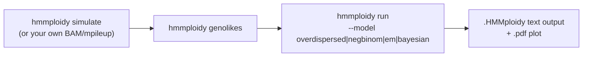

# HMMploidy: genotype-likelihood- and coverage-based Hidden Markov Model for inference of ploidy levels

Tools for inferring ploidy levels, testing for aneuploidy and other applications from
low/medium-coverage sequencing data.

**Version 2.0 is a full, pure-Python reimplementation of the toolchain.** The
original R (`HMMploidy.R`), Bash (`simulationScript.sh`) and R (`simulMpileup.R`)
scripts have been rewritten as a single `hmmploidy` Python package (the
genotype-likelihood calculator was already Python and has been kept, but its
inner read-parsing/likelihood loop was rewritten to be vectorised with numpy
instead of doing quadratic-time, character-by-character string processing).
The original scripts are still present in the repository for reference but are
superseded by the `hmmploidy` package described below.

Only one dependency is now required to run everything:

* Python >= 3.9, with `numpy, scipy, pandas, matplotlib` (and, for the optional
  Bayesian model, `pymc` + `arviz`). See [environment.yml](environment.yml).
* `numba` (compiled genotype-likelihood and HMM kernels).
* `samtools` only if you plan to feed BAM files directly into the genotype
  likelihood calculator (mpileup/mpileup.gz input does not need it).

```bash
conda env create -f environment.yml
conda activate hmmploidy
pip install -e .          # exposes the `hmmploidy` console script
```

## Overview of the pipeline



1. **`hmmploidy simulate`** - simulate polyploid sequencing data (mpileup format).
2. **`hmmploidy genolikes`** - compute per-site, per-ploidy genotype likelihoods.
3. **`hmmploidy run`** - fit the ploidy HMM (three interchangeable model choices, see below) and
   report/plot the inferred ploidy per genomic window.

## Modelling notes: depth + genotype-likelihood emissions, and model choices

The HMM has one state per candidate ploidy level (1..`maxPloidy`). At every
genomic window the model observes two pieces of evidence: the **mean read
depth** of the window, and the **genotype likelihoods** of the SNPs inside the
window (marginalised over the unknown allelic dosage under a
Binomial(ploidy, population-frequency) prior - see `hmmploidy.data.geno_loglik_for_ploidy`,
a direct translation of the original `pGenoDataAll`). The two sources of
evidence are combined additively in log-space and passed through the same
forward-backward/Viterbi machinery for all models (`hmmploidy.hmm.common`);
what differs between models is **only how the depth-emission density is
parameterised and fit**:

| Model (`--model`) | Depth emission | Fitting technique | Notes |
|---|---|---|---|
| `overdispersed` (default) | Gamma with mean `k * haploid_depth` (shared across states) + outlier component; allele counts are **Beta-Binomial** with overdispersion `rho` | Baum-Welch EM (closed-form haploid depth, 1-D Newton for the Gamma shape); `rho` chosen by maximising the penalised HMM likelihood over a grid; sticky Dirichlet prior on self-transitions; multi-start over whole-genome ploidy | Computes its own genotype likelihoods from per-SNP allele counts, so allelic overdispersion (reference bias, mapping artefacts) does not produce overconfident wrong calls. `rho = 0` recovers the Binomial model. The dosage prior uses leave-one-out population allele frequencies (from the *other* individuals) integrated over their uncertainty, which avoids an upward bias for deep samples in small cohorts. See `hmmploidy/hmm/overdispersed.py`. |
| `negbinom` | Negative Binomial (mean `alpha/beta`) | Conditional EM with a Newton-Raphson M-step for `alpha` | Direct translation of the original `HMMploidy.R`. Captures depth over-dispersion, but the Newton-Raphson step can be unstable on noisy/small data. |
| `em` | Poisson | Baum-Welch EM with a **closed-form** M-step (weighted mean) | New, added per request. Faster and more numerically stable than `negbinom` because no Newton-Raphson is needed; slightly less flexible since it does not model over-dispersion explicitly (windowing already reduces variance). Good default for quick/exploratory runs. |
| `bayesian` | Negative Binomial, with `mu_k = haploid_depth * k` shared across states | Hierarchical Bayesian model fit with PyMC/NUTS | New, added per request. Shares statistical strength across ploidy states through a single haploid-depth parameter, propagates full posterior uncertainty (not just a point estimate), and is more robust in low-window-count regimes. The final ploidy path is obtained by plugging posterior-mean parameters into the same Viterbi decoder used by the other two models. |

Why these choices: a plain Negative Binomial fit **independently** per ploidy
state (as in the original model) can be over-parameterised when the number of
windows is small, since each state's `alpha`/`beta` are estimated with no
information sharing. Tying the mean of every state to a single haploid-depth
parameter (as in the `bayesian` model) is a more parsimonious, biologically
motivated alternative, and a hierarchical/Bayesian treatment additionally
propagates parameter uncertainty into the ploidy calls instead of only
reporting a point estimate. The `em` (Poisson) alternative trades away
over-dispersion modelling for a much simpler, closed-form, faster-converging
EM update, which is attractive when speed matters or when data are already
reasonably well window-averaged.

`hmmploidy run` also implements a simplification relative to the original R
script: the original tried to automatically *remove* candidate ploidy states
during EM iterations via a combinatorial BIC search. This is not reimplemented
(it was O(2^maxPloidy) and hard to keep numerically stable); instead all
`maxPloidy` states are always kept, and states with negligible posterior
support can simply be ignored downstream.

## 1. Simulation of polyploid data: `hmmploidy simulate`

Overview: simulate polyploid organisms and output them in `mpileup.gz` format. Pure-Python
replacement for `simulationScript.sh` + `simulMpileup.R`, with an added choice of
depth-generating distribution.

```Shell
hmmploidy simulate -p $FILE -d $DEPTH -l $LOCI -o $OUTNAME [--depth-model poisson|negbinom]
```

### Input

* `-p` or `--ploidyFile`: file containing the desired simulated data (same syntax as before).
  Each line of the `ploidyFile` contains the ploidy number and the number of individuals for $K$
  adjacent segments of a number $J$ of genomes. Example: $K=3$ adjacent segments and $20$ genomes.
  The first segment is diploid for all $20$ genomes, the second is diploid for 10 genomes and
  tetraploid for 10 genomes, and the third is triploid for all genomes.
  ```Shell
  2x20
  2x10,4x10
  3x20
  ```
  The length of each segment is expressed by the `--loci` parameter below.
* `-l` or `--loci`: comma-separated number of loci $l_1,l_2,...,l_K$ used in each simulated segment.
* `-d` or `--depth`: comma-separated haploid depths to simulate. For each depth, a compressed
  `mpileup` file is created.
* `-o` or `--out`: output file name prefix. Default: `out`.
* `--depth-model {poisson,negbinom}`: distribution used to generate per-site sequencing depth
  (default `poisson`, matching the original script). Use `negbinom` to generate over-dispersed
  depths and stress-test how the three `hmmploidy run` models behave under a mismatched
  depth-generating process; control the amount of over-dispersion with `--dispersion` (Negative
  Binomial size parameter, smaller = more over-dispersion).
* `--depth-cv CV` / `--depth-block N`: add a regional log-normal coverage bias with coefficient of
  variation `CV`, shared by blocks of `N` loci (default 50). Unlike per-site noise, it does not
  average out within windows (mimics GC/mappability bias).
* `--allele-overdispersion RHO`: make allele read counts at heterozygous sites Beta-Binomial with
  intra-class correlation `RHO` (mimics reference bias / mapping artefacts).
* `-q/--qual, -k/--ksfs, -r/--pvar, -a/--panc, -n/--ne, -e/--errdepth, -u/--seed`: same meaning
  and defaults as the original `simulMpileup.R` options.

### Output

One `<out_prefix>.DP<depth>.mpileup.gz` file per haploid depth, plus a `<out_prefix>.filelist`
listing the generated basenames (ready to feed into `hmmploidy genolikes` / `hmmploidy run`).

### Example

```Shell
hmmploidy simulate -p ploidy.file -d 10,20 -l 1000,1000,1000 -o outFile
```

with `ploidy.file` containing:
```Shell
2x20
2x10,4x10
3x20
```

produces `outFile.DP10.mpileup.gz`, `outFile.DP20.mpileup.gz` and `outFile.filelist`.

## 2. Calculate genotype likelihoods: `hmmploidy genolikes`

Overview: calculate genotype likelihoods from BAM or mpileup input.

```Shell
# one BAM per individual, piled up jointly into ONE genolikes file
hmmploidy genolikes --bamList bams.txt --ref_fasta reference.fa --outName mypop [options]

# or: one or more multi-sample mpileup files (one genolikes file each)
hmmploidy genolikes names.filelist [options]
```

### Input

* `-b`/`--bamList`: file listing one BAM per individual (one per line). All BAMs are piled up
  **jointly** with `samtools mpileup` (streamed, no intermediate file), so population allele
  frequencies use every individual. If every BAM is indexed (`samtools index`), the genome is
  split into `--region_size` bp regions (default 10 Mb) processed in parallel. The output is
  `<outName>.genolikes.gz`, plus `<outName>.names` with the sample names (usable as
  `hmmploidy run --nameFile`). Requires `samtools` and `-r`/`--ref_fasta`. A positional list made
  only of `.bam` files is treated the same way.
* `names.filelist` (positional): names of multi-sample mpileup files (`.mpileup` or
  `.mpileup.gz`), one per line; each gives one `<name>.genolikes.gz`.
* `-O`/`--outName`: output basename for BAM input (default: the list file name without extension).
* `-t`/`--threads`: worker processes (default `min(8, nr of CPUs)`).
* `--min_mapq`: minimum mapping quality for BAM input (`samtools mpileup -q`, default `0`).
* `--mpileup_args`: extra options passed verbatim to `samtools mpileup`, e.g. `"-B -Q 0"`.
* `--chunk_size`: mpileup lines per work unit (default `20000`).
* `-o` or `--outFolder`: Output folder. Default: the folder of each input file.
* `-i` or `--Inbreeding`: accepted for CLI compatibility with the original script (comma separated,
  e.g. `0.2x3,0.4`); as in the original implementation it is currently not folded into the
  likelihood model.
* `-p` or `--ploidyFile`: file with one ploidy level per line to test (default `1,2,3,4,5,6`).
* `-d` or `--downsampling`: fraction of reads to keep per site (default `1`).
* `-m` or `--min_non_major_freq` (default `0.2`), `-M2`/`--max_minor2_freq` (default `0.1`),
  `-M3`/`--max_minor3_freq` (default `0.1`), `-dp`/`--min_global_depth` (default `0`),
  `-dpInd`/`--min_ind_depth`: same filtering thresholds as the original script. Sites are kept
  only if every individual has depth `> min_ind_depth`. **The default is now `-1`**, which keeps
  sites where some individuals have no reads (their genotype likelihoods are then uninformative).
  The old default `0` dropped every site not covered in all individuals, which removes almost all
  sites when there are many low-coverage samples.
* `-q`/`--min_quality_score`: minimum base quality to keep a read (default `1`).
* `-s` or `--random_seed`: random seed for the downsampling step.
* `-r` or `--ref_fasta`: reference fasta, required for BAM input.

### Output

A `.genolikes.gz` file (per mpileup, or one for a BAM list), tab separated, with columns: chromosome, position, individual
number, reference allele, site depth, major allele, minor allele, major allele count, minor
allele count, genotype likelihoods at ploidy 1 (2 columns), ploidy 2 (3 columns), ... up to the
highest requested ploidy.

### Example

```Shell
hmmploidy genolikes names.filelist -p ploidyFile -d 0.9 -m 0.2 -M2 0.15 -M3 0.1 -dp 5 -s 1
hmmploidy genolikes --bamList bams.txt -r ref.fa -O mypop --min_mapq 20 -t 16
```

Soft-masked (lowercase) reference bases are handled: reads matching the reference are counted
whatever the case of the reference base.

## 3. Infer ploidy levels: `hmmploidy run`

Overview: infer ploidy levels for each individual in a `.genolikes` file using sequencing depth
and genotype likelihoods, with a choice of four HMM fitting techniques (see the modelling notes
above).

```Shell
hmmploidy run --fileList $FILELIST --wind $WIND --model {overdispersed,negbinom,em,bayesian} [options]
```

### Input

* `--file`: a single `.genolikes` basename, or `--fileList`: a file listing basenames (one per
  line). `<basename>.genolikes` and `<basename>.genolikes.gz` are both read directly, and the
  mpileup file list given to `hmmploidy genolikes` can be reused as is.
* `--model`: `overdispersed` (default, overdispersion-aware), `negbinom` (classic), `em` (fast Poisson EM), or `bayesian` (PyMC hierarchical model).
* `--wind`: window size in base pairs; windows without SNPs are merged into a neighbour. Aim for
  tens of SNPs per window.
* `--maxPloidy`: max number of candidate ploidy levels (default `6`).
* `--ploidyList`: comma-separated ploidies actually present as columns in the `.genolikes` file,
  if different from `1..maxPloidy`.
* `--nameFile`: file with one individual name per line (default: `ind1, ind2, ...`).
* `--chosenInd`: comma-separated 1-indexed individuals to analyze (default: all).
* `--quantileTrim`: two comma-separated quantiles used to trim depth outliers (default `0.02,0.98`).
* `--SNPtrim`: two comma-separated allele-frequency thresholds used to select SNPs (default `0.1,0.9`).
* `--minInd`: min number of individuals with data for a locus to be used in the population
  allele-frequency estimate (default `1`).
* `--eps`: sequencing/mapping error rate (default `0.0005`).
* `--truePl`: true ploidy, if known (e.g. from simulations), overlaid on the plot.
* `-t`/`--threads`: individuals fitted in parallel (default `min(8, nr of CPUs)`).
* `--noPlot`: skip the per-individual PDF plots (faster for many individuals).

### Output

For each individual: a `<prefix>.<name>.pdf` plot (inferred ploidy path + posterior support, and
window-mean depth with the fitted per-state mean), and a `<prefix>.<name>.HMMploidy` text file
with the fitted `delta`, `trans`, `mu` (plus `haploid_depth`, `depth_shape`,
`allele_overdispersion_rho` and `error_rate` for the `overdispersed` model, `alpha`/`beta` for
the `negbinom` model), final
log-likelihood, per-window inferred ploidy, per-ploidy posterior proportions, and window
boundaries.

### Example

```Shell
hmmploidy run --fileList poliploidyGenome.filelist --model em --wind 100 --maxPloidy 5 --minInd 2
```

### Notes

Each `.genolikes` file is expected to contain one or more chromosomes/contigs; contigs are
analyzed independently, windows never straddle a contig boundary, and contigs without SNPs are
automatically skipped.

## Application example: end-to-end, all models

```Shell
hmmploidy simulate -p ploidy.file -d 3,8 -l 1000,1000,1000,1000 -o poliploidyGenome
# ploidy.file: 2x5 / 5x5 / 4x5 / 2x5

hmmploidy genolikes poliploidyGenome.filelist

for model in overdispersed negbinom em bayesian; do
    hmmploidy run --fileList poliploidyGenome.filelist --model $model --maxPloidy 5 --wind 100 --minInd 2 --outSuffix $model
done
```

See [notebooks/demo_HMMploidy.ipynb](notebooks/demo_HMMploidy.ipynb) for the model explanations,
a benchmark of all models under different kinds of overdispersion (`hmmploidy.benchmark`),
speed measurements, and a runnable BAM example.

